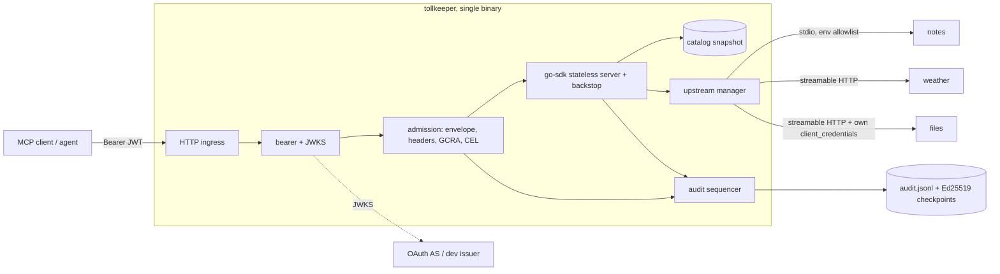
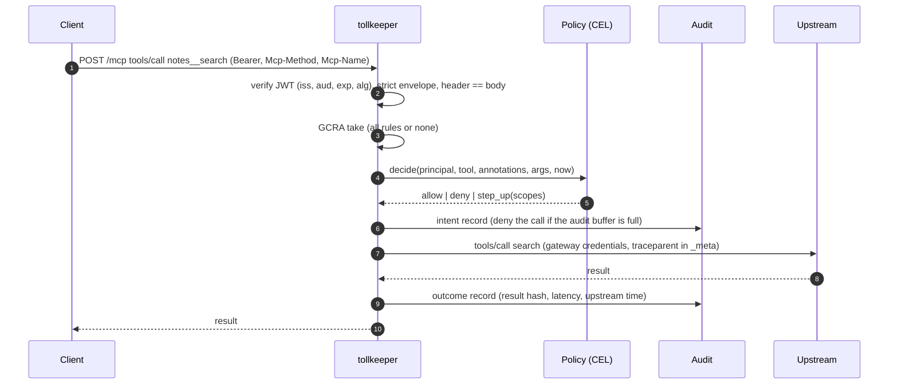

# tollkeeper

**A single Go binary between your agents and their MCP tools: OAuth 2.1 resource server, policy-as-code in CEL, GCRA rate limits, and an audit log you can cryptographically verify.**

   

## Why

- Every MCP server you connect is a new door into your systems, and the spec now forbids the shortcut most proxies take: **forwarding the caller's token upstream** (the official Go proxy example forwards every inbound header, `Authorization` included). tollkeeper validates the token, then calls upstreams with its *own* credentials.
- "Who called which tool with what, and was it allowed?" is the question compliance teams ask. Most gateways answer it with logs anyone with database access can quietly rewrite. tollkeeper writes a **SHA-256 hash chain with Ed25519-signed checkpoints**, and `tollkeeper audit verify` names the exact record that was changed or deleted.
- Overhead is measured, not claimed: see [Benchmarks](#benchmarks).

## What it does

| Concern | How |
|---|---|
| Transport | Stateless Streamable HTTP for MCP `2026-07-28`, with fallback for `2025-11-25` clients (go-sdk v1.8.0) |
| Aggregation | N upstreams (stdio subprocesses and Streamable HTTP) under `upstream__tool` names, sorted and deterministic, re-synced on upstream `list_changed` and a 60 s poll, with health probes and crash-loop backoff |
| Authentication | RFC 9728 protected-resource metadata, JWT via JWKS (`iss`, `aud` = canonical URI per RFC 8707, `exp`, algorithm allowlist), RFC 6750 challenges with `error=` and all required scopes |
| No passthrough | Upstream HTTP clients are built from config only and never see the inbound request; covered by tests |
| Authorization | First-match rules: static RBAC fast path plus optional CEL `when` over principal, tool annotations, arguments and time; default deny; `tools/list` filtered per caller; step-up challenges (`403 insufficient_scope`) |
| Rate limiting | GCRA, lock-free CAS on one `int64` per key, per subject / subject+tool / client / upstream / tool / global, all-or-nothing across rules, `429` + `Retry-After` + IETF `RateLimit` headers |
| Audit | Intent + outcome records, hashed arguments by default (GDPR data minimisation), batched fsync, Ed25519 checkpoints, chain continuity across restarts. `fail_closed` refuses calls when the buffer is full *or* the disk is failing; lost events become signed gap records |
| Request hygiene | Strict JSON-RPC envelope parsing that rejects batches and duplicate or Unicode case-folded keys at any depth of `arguments` (closing parser-differential policy bypasses), a 100k-token complexity cap, `Mcp-Method`/`Mcp-Name` header agreement (`-32020`), body cap |
| Observability | OTel traces with W3C context from headers or `_meta` (SEP-414), Prometheus metrics including `mcpgw_gateway_overhead_seconds` |
| Dev tooling | Built-in **DEV ONLY** OAuth issuer (client_credentials, authorization_code + PKCE S256, RFC 9207 `iss`), three demo MCP servers, a demo client and a benchmark harness, all in Go |

## Architecture





The admission step runs at the HTTP layer so it can answer with real status codes (`401`, `403` step-up, `429`). The go-sdk middleware then acts as a backstop: a `tools/call` without a matching admission never reaches an upstream.

## Quickstart

Requires Docker with BuildKit/buildx (default in Docker Desktop and the docker-ce packages; on distributions that split it out, install `docker-buildx`), or rootless Podman exposing its Docker socket, plus Go 1.27 for the demo client.

```bash
git clone https://github.com/Guilherme-Ciano/tollkeeper && cd tollkeeper
```

```bash
docker compose up --build -d --wait
```

```bash
go run ./cmd/democlient
```

This is the real output of that command against the compose stack:

```text
1. alice (reader) logs in with authorization_code + PKCE
  logged in as alice, granted scope "mcp:tools"
2. tools visible to alice (8):
   - files__delete_file
   - files__list_files
   - files__read_file
   - notes__create
   - notes__get
   - notes__search
   - weather__forecast
   - weather__slow_forecast
3. notes__search (stdio upstream) -> {"notes":[{"body":"Hash-chained audit log with Ed25519 checkpoints.","id":"1","title":"Gateway design"}]}
4. files__list_files (OAuth-protected upstream, gateway uses its own client_credentials) -> {"files":["/docs/readme.md","/tmp/old.log","/tmp/scratch.txt"]}
5. alice calls files__delete_file -> HTTP 403
   WWW-Authenticate: Bearer error="insufficient_scope", error_description="additional scope required", resource_metadata="http://localhost:8080/.well-known/oauth-protected-resource/mcp", scope="mcp:tools files:write"
   {"jsonrpc":"2.0","id":1,"error":{"code":-32001,"message":"insufficient scope","data":{"required_scopes":["files:write"]}}}
6. bob steps up with files:write
  logged in as bob, granted scope "mcp:tools files:write"
   bob calls files__delete_file -> HTTP 200 {"jsonrpc":"2.0","id":1,"result":{...,"structuredContent":{"deleted":"/tmp/old.log"},"resultType":"complete"}}
7. alice bursts weather__forecast
   call 1 -> HTTP 200
   ...
   call 5 -> HTTP 200
   call 6 -> HTTP 429 Retry-After=2 "weather-per-subject";r=0;t=10
```

Verify the audit chain inside the container, then tamper with a copy:

```bash
docker compose exec gateway /usr/local/bin/tollkeeper audit verify -f /var/log/tollkeeper/audit.jsonl --pubkey /var/lib/tollkeeper/keys/audit-ed25519.pub --chain-id compose-gateway
```

```text
OK chain=compose-gateway records=21 events=20 checkpoints=1 last_seq=21 last_hash=b702fc70… unsigned_tail=0
```

After changing `"sub":"bob"` to `"sub":"eve"` on one line, or deleting one line:

```text
FAIL line 7 (seq 7): hash mismatch: record content was modified after 6 valid records
FAIL line 9 (seq 10): sequence gap: expected seq 9 after 8 valid records
```

## CLI

| Command | Purpose |
|---|---|
| `tollkeeper serve -c config.yaml` | Run the gateway |
| `tollkeeper config validate -c config.yaml` | Validate config, compile CEL rules and rate limits, report every bad field with its path |
| `tollkeeper policy test -c config.yaml -f policies_test.yaml` | Table-driven policy fixtures for CI ([example](deploy/compose/policies_test.yaml)) |
| `tollkeeper audit verify -f audit.jsonl --pubkey audit.pub` | Recompute the chain, check signatures, report the first broken record. Fails when a log has no signed checkpoint or more than `--max-unsigned` (default 1000) records after the last one; `--chain-id` pins the chain; `--no-signatures` checks only the hash chain |
| `tollkeeper audit keygen -o dir` | Ed25519 checkpoint key pair |
| `tollkeeper dev-issuer -c devissuer.yaml` | DEV ONLY OAuth issuer (refuses non-loopback binds without `--i-know-this-is-insecure`) |
| `tollkeeper healthcheck --url …` | Probe for distroless container healthchecks |

## Configuration

YAML with `${ENV}` expansion (missing or multi-line values are rejected) and an env overlay (`TOLLKEEPER_SERVER__LISTEN=:8081`). Unknown keys are errors. A complete example is [deploy/compose/gateway.yaml](deploy/compose/gateway.yaml).

```yaml
policy:
  default: deny
  rules:
    - name: readers-can-read
      subjects: { scopes_any: ["mcp:tools"] }
      tools: ["notes__search", "weather__*"]
      effect: allow
    - name: notes-create-capped
      subjects: { scopes_any: ["mcp:tools"] }
      tools: ["notes__create"]
      when: "has(args.body) && size(args.body) <= 4096"
      effect: allow
    - name: destructive-needs-step-up
      tools: ["files__delete_file"]
      when: '"files:write" in principal.scopes'
      effect: allow
      on_deny: { step_up_scopes: ["files:write"] }
```

| Key | Default | Notes |
|---|---|---|
| `server.listen` / `admin_listen` | `:8080` / `127.0.0.1:9090` | Admin serves `/metrics`, `/livez`, `/readyz`; `server.pprof: true` adds `/debug/pprof` and requires a loopback admin address |
| `server.public_url` | required | Canonical MCP URL; also the RFC 9728 metadata path |
| `server.max_body_bytes` | 1 MiB | Enforced before parsing |
| `auth.mode` | `jwt` | `none` exists for local experiments and logs a warning |
| `auth.jwt.algorithms` | RS256, ES256, EdDSA | HS* and `none` are never accepted |
| `auth.jwt.types` | any | e.g. `["at+jwt"]` to accept only RFC 9068 access tokens |
| `upstreams[].transport` | | `stdio` (explicit env allowlist, process-group kill) or `streamable_http` |
| `upstreams[].auth.type` | `none` | `bearer` or `client_credentials` with RFC 8707 `resource` |
| `rate_limits.rules[].per` | | `subject`, `subject_tool`, `client_id`, `upstream`, `tool`, `global` |
| `audit.record_args` | `hash` | `none`, `hash`, `full` (raw arguments may be personal data) |
| `audit.on_backpressure` | `fail_closed` | Calls are refused if their intent record cannot be queued |

CEL variables: `principal{sub, client_id, scopes, claims}`, `tool{name, upstream, original, pin_hash, annotations}`, `args`, `request{method, client_name}`, `now`. Programs are compiled at load time with a cost limit and a 50 ms evaluation timeout, and arguments are only decoded when a rule references `args`.

## Benchmarks

<!-- bench:start -->
Benchmarks are being re-run on a quiet machine; see `bench/results` for the committed raw numbers.
<!-- bench:end -->

Reproduce with `make bench` (micro-benchmarks, `-count=10`) and `make bench-e2e` (gateway vs. direct at constant arrival rates; methodology in [bench/README.md](bench/README.md)).

## Security model

| Threat | Mitigation |
|---|---|
| Token from another resource replayed here | `aud` must equal the canonical URI, `iss` pinned, algorithm allowlist, `exp` required |
| Token passthrough / confused deputy | Upstream clients have no access to inbound requests; per-upstream credentials; policy runs before every upstream call |
| Credential exfiltration via redirect | Upstream, token and JWKS clients never follow redirects; a static bearer is only attached for the configured upstream host |
| Header/body or parser-differential bypass | Strict envelope parser rejects duplicate and Unicode case-folded keys, including nested inside `arguments` (so `{"path":"/tmp/x","PATH":"/etc/shadow"}` never reaches a case-insensitive upstream decoder); `Mcp-Method`/`Mcp-Name` must match the body; MCP-layer backstop re-checks the admitted tool name; forwarding re-checks the approved pin |
| Cross-server tool shadowing | Mandatory `upstream__tool` namespacing; the separator must use a character upstream IDs cannot contain; the catalog refuses a name already owned by another upstream |
| Tool discovery through errors | Unknown tools get the same response as policy denials, and denials never name the matching rule |
| Malicious upstream tool definitions | Tools with invalid schemas are quarantined instead of crashing the server (go-sdk `AddTool` panics); pin hashes recorded per call |
| Audit tampering or loss | Hash chain + Ed25519 checkpoints that are themselves chain records; verifier rejects unknown fields and logs without signatures; disk failures fail closed, truncate partial batches and leave signed gap records |
| Secret leakage to stdio servers | Subprocesses get an explicit env allowlist, never the gateway's environment (tested) |
| DoS | Body cap, argument token cap, CEL cost limit and timeout, per-upstream semaphores that fail fast, timeouts and circuit breakers that ignore client-caused errors, rate limits applied before catalog lookups, rate-limited JWKS refetch on unknown `kid`, bounded metric labels, truncated audit fields |

Report vulnerabilities as described in [SECURITY.md](SECURITY.md).

## Known limitations (v0.1)

- **Tools only.** Resources and prompts are not aggregated yet; go-sdk has no dynamic `resources/list` handler ([go-sdk#998](https://github.com/modelcontextprotocol/go-sdk/issues/998)).
- **Progress notifications are not forwarded**, and if they were, go-sdk may deliver them after the result ([go-sdk#1337](https://github.com/modelcontextprotocol/go-sdk/issues/1337)).
- **MRTR `requestState` is passed through, not yet sealed**; tool names still route retries, so a client cannot redirect a retry to another upstream by name.
- **Tool pinning** computes and records hashes but does not enforce approval yet.
- **In-memory rate limits only**; limits are per replica. One audit chain per replica (`chain_id`).
- Upstream results pass through unchanged, including the upstream's `_meta` server info.
- Records written after the last checkpoint are protected only by the hash chain until the next checkpoint (`checkpoint.every`/`interval`); `audit verify --max-unsigned` bounds how many are accepted. Truncating them is not detectable without external anchoring.
- `subscriptions/listen` is not offered and `tools.listChanged` is not advertised; clients re-list tools.
- Rate-limit tokens are spent by calls that are later denied by policy, and the idle-key janitor can grant at most one extra request on a key it races with.
- Intent and decision records share one audit queue, so a flood of rejected calls can delay intents (bounded by rate limits and the 100 ms intent deadline).
- A torn last line (only possible with `fsync: false`) makes startup refuse to continue the chain until the file is repaired.

## Roadmap

- [x] v0.1: everything above, compose demo, fuzzing, published overhead numbers
- [ ] v0.2: Redis GCRA store with a shared conformance suite, Postgres audit sink with immutable triggers, OTLP log sink, RFC 7662 introspection, pin enforcement and `pin approve`, sealed MRTR state, progress forwarding, resources/prompts, hot reload
- [ ] v1.0: RFC 8693 token exchange to upstreams, DPoP, external checkpoint anchoring, Helm chart, MCP conformance suite in CI

## Development

```bash
make lint test build
```

The codebase has **zero code comments** (only `//go:` directives), enforced by `go run ./internal/tools/nocomments` in `make lint` and CI. Names and tests carry the intent; design rationale lives in [docs/adr](docs/adr). See [CONTRIBUTING.md](CONTRIBUTING.md).

## License

Apache-2.0
