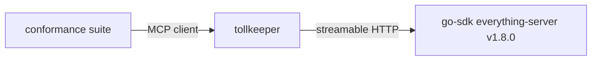

# MCP conformance

CI runs the official [MCP conformance suite](https://github.com/modelcontextprotocol/conformance) against tollkeeper, not against an SDK fixture. The setup proves what a client sees *through* the gateway:



- The upstream is the go-sdk reference fixture (`conformance/everything-server`), which itself passes the suite, so any new failure is tollkeeper's.
- [`gateway.yaml`](gateway.yaml) runs with `auth.mode: none` and an allow-all policy, because the server scenarios do not carry tokens, and with `server.namespace_tools: false` so tool names match the scenarios. Authentication and policy are covered by tollkeeper's own tests.
- Both requirement sets run. `2026-07-28` (stateless, the revision tollkeeper targets) fails CI on any regression; `2025-11-25` (stateful clients through the legacy fallback) is reported but advisory, because server-initiated requests for legacy clients are a documented limitation.

## Expected failures

[`baseline.yml`](baseline.yml) lists the scenarios tollkeeper does not pass yet, each matching a documented limitation:

| Scenarios | Reason |
|---|---|
| `resources-*`, `sep-2164-resource-not-found`, `prompts-*`, `completion-complete` | Only tools are aggregated in v0.1; go-sdk has no dynamic `resources/list` handler ([go-sdk#998](https://github.com/modelcontextprotocol/go-sdk/issues/998)) |
| `tools-call-with-progress` | Progress notifications are not forwarded yet ([go-sdk#1337](https://github.com/modelcontextprotocol/go-sdk/issues/1337)) |

Each entry is removed in the change that makes its scenario pass, so the file only shrinks as features land.

## Running locally

```bash
go install github.com/modelcontextprotocol/go-sdk/conformance/everything-server@v1.8.0
```

```bash
everything-server -http=127.0.0.1:3001 -stateless &
```

```bash
go run ./cmd/tollkeeper serve -c conformance/gateway.yaml &
```

```bash
npx -y @modelcontextprotocol/conformance@0.2.0-alpha.12 server --url http://localhost:8080/mcp --requirements 2026-07-28 --expected-failures conformance/baseline.yml
```
