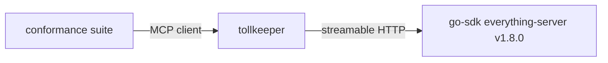

# MCP conformance

CI runs the official [MCP conformance suite](https://github.com/modelcontextprotocol/conformance) against tollkeeper, not against an SDK fixture. The setup proves what a client sees *through* the gateway:



- The upstream is the go-sdk reference fixture (`conformance/everything-server`), which itself passes the suite, so any new failure is tollkeeper's.
- [`gateway.yaml`](gateway.yaml) runs with `auth.mode: none` and an allow-all policy, because the server scenarios do not carry tokens, and with `server.namespace_tools: false` so tool names match the scenarios. Authentication and policy are covered by tollkeeper's own tests.
- Both requirement sets run. `2026-07-28` (stateless, the revision tollkeeper targets) fails CI on any regression; `2025-11-25` (stateful clients through the legacy fallback) is reported but advisory, because server-initiated requests for legacy clients are a documented limitation.

## Expected failures

[`baseline.yml`](baseline.yml) lists the scenarios tollkeeper does not pass yet, each matching a documented limitation:

| Scenarios | Reason |
|---|---|
| `tasks-*` | The tasks extension (SEP-2663) is not proxied. Neither go-sdk (v1.8.0, v1.9.0-pre.1) nor its reference fixture implements it: run directly against the fixture, the suite fails the same 30 checks, so there is no upstream to proxy tasks to yet |

Apart from the baseline, the gateway passes every check the fixture passes when tested directly, including the `subscriptions/listen` checks.

Each entry is removed in the change that makes its scenario pass, so the file only shrinks as features land.

The `2025-11-25` run has its own [`baseline-2025-11-25.yml`](baseline-2025-11-25.yml). Clients on that version talk to the gateway through go-sdk's stateful fallback, and the gateway does not relay what an upstream sends back to such a client mid-call: sampling and elicitation requests (`tools-call-sampling`, `tools-call-elicitation`, `elicitation-*`), log messages (`logging-set-level`, `tools-call-with-logging`) and progress (`tools-call-with-progress`, relayed only on 2026-07-28). It also does not offer `resources/subscribe` (`resources-subscribe`, `resources-unsubscribe`) or the legacy standalone SSE stream (`server-sse-multiple-streams`). The 2026-07-28 equivalents of these features pass.

The run step uses `set -o pipefail`. Without it, the `tee` that saves the output hid the suite's exit code, and the job passed even when scenarios outside the baseline failed.

## Running locally

```bash
go install github.com/modelcontextprotocol/go-sdk/conformance/everything-server@v1.8.0
```

```bash
everything-server -http=127.0.0.1:3001 -stateless &
```

```bash
go run ./cmd/tollkeeper serve -c conformance/gateway.yaml &
```

```bash
npx -y @modelcontextprotocol/conformance@0.2.0-alpha.12 server --url http://localhost:8080/mcp --requirements 2026-07-28 --expected-failures conformance/baseline.yml
```
