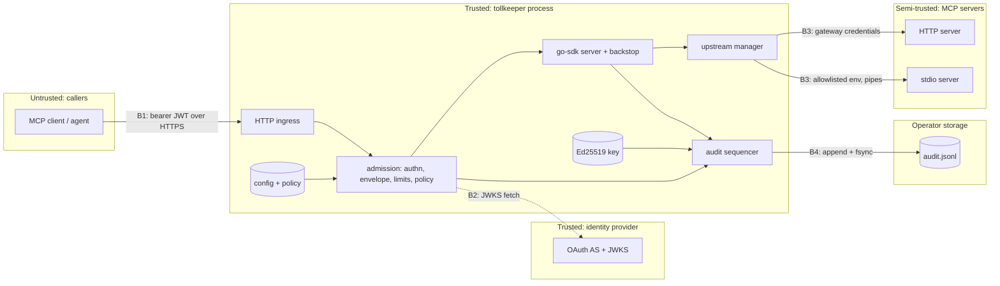

# Threat model

Scope: tollkeeper v0.1 deployed as a gateway between MCP clients (agents, IDEs, applications) and a set of MCP servers. Method: data-flow diagram with trust boundaries, then STRIDE per element. Each threat lists its mitigation and where it is enforced or tested, so the model can be checked against the code rather than taken on trust.

## Assets

| Asset | Why it matters |
|---|---|
| Upstream capabilities | Tools can read files, write data and call internal APIs. Unauthorised invocation is the primary harm |
| Caller tokens | A leaked token lets an attacker act as the caller wherever that token is accepted |
| Gateway upstream credentials | Static bearers and `client_credentials` secrets grant the gateway's own access to every upstream |
| Audit log and signing key | Evidence of who did what. Forged or deleted records destroy accountability |
| Policy and configuration | Whoever edits them decides what agents may do |
| Tool definitions | Descriptions are read by models as instructions; a changed description can redirect an agent |

## Data flow and trust boundaries

Upstreams are **semi-trusted**: the operator chose them, but their tool definitions and results are untrusted input, because a server can be compromised or change behaviour after approval.

## STRIDE

### B1: caller to ingress

| | Threat | Mitigation | Where |
|---|---|---|---|
| S | Replay of a token minted for another resource | `aud` must equal the canonical resource URI (RFC 8707), `iss` pinned, `exp` required, algorithm allowlist | `internal/authn`, `authn_test.go` |
| S | Algorithm confusion (`none`, HS256 with a public key) | Allowlist of asymmetric algorithms only; key type must match `alg` | `internal/authn` |
| T | Parser differential: body read one way by policy and another way by the upstream | Strict envelope parser rejects batches, duplicate keys and Unicode case-folded duplicates at any depth; header and body must agree | `internal/gateway/envelope.go`, `FuzzParseEnvelope`, `FuzzRejectDuplicateKeys` |
| R | Caller denies having made a call | Intent and outcome records carry subject, client, tool, argument hash and trace id before the upstream is called | `internal/audit` |
| I | Tool enumeration through error differences | Unknown tools and policy denials return the same response; denials never name the rule | `internal/gateway/admission.go` |
| D | Large or deeply nested bodies | Body cap, argument token cap, CEL cost limit and timeout | `internal/gateway`, `internal/policy` |
| D | Request floods | GCRA limits applied before catalog lookup and policy | `internal/ratelimit` |
| E | Calling a tool outside the caller's grant | Default-deny first-match policy; step-up via `403 insufficient_scope`; go-sdk backstop refuses unadmitted calls | `internal/policy`, `backstop_test.go` |

### B2: gateway to identity provider

| | Threat | Mitigation | Where |
|---|---|---|---|
| S | JWKS served by an attacker through redirect or plain HTTP | JWKS client never follows redirects; a plain `http` JWKS URL is rejected unless `auth.jwt.allow_insecure_jwks` is set | `internal/authn/jwks.go`, `internal/config/validate.go` |
| D | Unknown `kid` forcing refetch storms | Rate-limited refetch on unknown `kid`; cached keys keep serving | `internal/authn/jwks.go` |

### B3: gateway to upstreams

| | Threat | Mitigation | Where |
|---|---|---|---|
| S | Confused deputy via forwarded caller token | Upstream clients built from config only, no access to the inbound request ([ADR 0005](adr/0005-no-token-passthrough.md)) | `internal/upstream`, no-passthrough tests |
| S | Upstream shadowing another server's tool | Mandatory `upstream__tool` namespacing; catalog refuses names owned by another upstream | `internal/catalog`, `FuzzQualify` |
| T | Rug pull: an approved tool silently changes its description or schema | Tool definitions are pinned by hash; in `enforce` mode a changed tool is hidden and blocked until re-approved ([ADR 0007](adr/0007-tool-pinning.md)) | `internal/pin`, `internal/gateway/pin_test.go` |
| T | Tool poisoning: instructions hidden in descriptions, titles, schemas or `_meta` | The pin covers the full definition; `pin approve` shows a unified diff with hidden characters escaped, asks per tool, and rejects a report whose pin does not match its definition | `internal/cli/pin.go`, `pin_test.go` |
| T | Lockfile rewritten to self-approve | Lockfile refused when group or world writable; deploy it on a read-only mount | `internal/pin` |
| I | Hidden tools revealed through the pin report | `GET /pins` only on a loopback admin listener or with a bearer token; absent when pinning is off | `internal/app/pins_test.go` |
| I | Gateway environment leaked to stdio servers | Explicit environment allowlist | `internal/upstream`, env tests |
| I | Credentials sent to a redirected host | No redirects; static bearer bound to the configured host | `internal/upstream/transport.go` |
| D | Slow or crashing upstream exhausting the gateway | Per-upstream semaphores that fail fast, timeouts, circuit breakers, crash-loop backoff | `internal/upstream` |
| E | Malformed tool schema crashing the server | Invalid tools are quarantined instead of registered | `internal/gateway/gateway.go` |

### B4: gateway to audit storage

| | Threat | Mitigation | Where |
|---|---|---|---|
| T | Editing, deleting or reordering records | SHA-256 hash chain over stored bytes; `audit verify` names the first bad sequence number ([ADR 0001](adr/0001-verifiable-audit-log.md)) | `internal/audit`, `FuzzVerify` |
| T | Forging checkpoints | Ed25519 signatures over a domain-separated message; verifier requires a public key by default | `internal/audit/verify.go` |
| T | Rows rewritten in a database sink | Triggers reject `UPDATE`, `DELETE` and `TRUNCATE`, and recompute each row's hash and chain link on `INSERT`; the gateway role holds only `INSERT` and `SELECT` ([ADR 0009](adr/0009-shared-state-redis-postgres.md)) | `internal/audit/pgsink` |
| R | Losing records silently on disk failure | `fail_closed` stops admitting calls; lost events become signed gap records | `internal/audit/log.go` |
| D | Full disk blocking every call | Fail-closed by design; alert on `mcpgw_audit_*` metrics | runbook in README |

### Configuration and process

| | Threat | Mitigation |
|---|---|---|
| T | Malicious policy change | Policy lives in version control; `policy test` fixtures run in CI; the SHA-256 of the loaded config file is logged at startup |
| I | Signing key read from disk | The gateway refuses to load a signing key readable by group or others; distroless non-root image; keys belong in a secret mount |
| E | Container escape from a stdio server | Out of scope for v0.1; stdio sandboxing (rlimits, Landlock) is on the roadmap |

## Residual risks

- Records written after the last checkpoint can be truncated by someone with write access to the log. `--max-unsigned` bounds acceptance; external anchoring is planned for v1.0.
- Tool **results** are passed through unchanged. Prompt injection inside results is the agent's problem to handle; the gateway records a hash of each result so incidents can be reconstructed.
- Upstreams see the gateway, not the end user, as the caller until RFC 8693 token exchange lands.
- A compromised identity provider can mint valid tokens. tollkeeper limits the damage with scopes and policy but cannot detect it.
- Rate limits are per replica unless the Redis store is configured, and pin approvals are only as consistent as the lockfile shipped to each replica.
