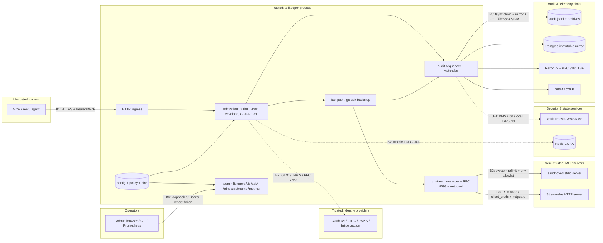

# Threat model

Scope: **tollkeeper v1.5+** deployed as a stateless security gateway between MCP clients (coding agents, orchestration frameworks, IDEs, user-facing agent UIs) and a set of MCP servers (stdio subprocesses and Streamable HTTP upstreams).

Method: data-flow diagram with explicit trust boundaries (`TB1`–`TB7`), STRIDE analysis per boundary mapped directly to enforcement packages and automated tests (including fuzzers and the dedicated adversarial suite in `internal/gateway/adversarial_test.go`), followed by deliberate stateless scope boundaries ([ADR 0020](adr/0020-stateless-governance-boundaries.md)) and residual risks.

## Assets

| Asset | Why it matters |
|---|---|
| Upstream capabilities | Tools can read files, mutate records, execute writes, and call internal APIs. Unauthorised invocation is the primary harm |
| Caller tokens & DPoP keys | A stolen bearer token lets an attacker impersonate the caller unless sender-constrained with RFC 9449 DPoP (`cnf.jkt`) |
| Gateway upstream credentials | Static bearers, `client_credentials` secrets, and RFC 8693 token-exchange client credentials grant upstream access |
| Audit log & checkpoint keys | Cryptographic evidence of who called what and why. Forged, altered, or truncated records destroy accountability |
| Policy, config & pin lockfile | Whoever modifies policy rules or approved tool hashes decides what agents may invoke |
| Tool definitions | Tool descriptions and schemas are consumed by LLMs as instructions; silent edits enable tool poisoning and rug pulls |
| Admin listener & report token | Exposes diagnostics, metrics, policy YAML, pin reports, call simulation, and audit tail |

## Data flow and trust boundaries

Upstreams are **semi-trusted**: the operator configured them, but their tool definitions, schemas, and responses are untrusted input because a server can be compromised, redirected, or mutated after initial approval.

## STRIDE

### B1: caller to data-plane ingress

| | Threat | Mitigation | Where |
|---|---|---|---|
| S | Replay of a token minted for another resource | `aud` must equal the canonical resource URI (RFC 8707), `iss` pinned, `exp` required, asymmetric algorithm allowlist | `internal/authn`, `authn_test.go` |
| S | Stolen bearer token replayed by another host | RFC 9449 DPoP (`auth.dpop.mode: required`) binds `dpop+jwt` to `cnf.jkt`, validates `htm`/`htu`/`ath`, rejects replayed `jti`, and supports rotating `DPoP-Nonce` ([ADR 0014](adr/0014-dpop-and-enterprise-idp.md)) | `internal/authn/dpop.go`, `adversarial_test.go` |
| S | Algorithm confusion (`none`, HS256 with a public key) | Asymmetric allowlist only (`RS256`, `ES256`, `EdDSA`); key type must match `alg` | `internal/authn` |
| T | Parser differential: body read one way by policy and another way by upstream | Strict JSON-RPC envelope parser rejects batches, duplicate keys, and Unicode case-folded keys at arbitrary depth in `arguments`; `Mcp-Method`/`Mcp-Name` headers must match body | `internal/gateway/envelope.go`, `FuzzParseEnvelope`, `FuzzRejectDuplicateKeys`, `adversarial_test.go` |
| R | Caller denies having invoked a tool or delegated agent | Intent and outcome records capture `sub`, `tenant`, `act` delegation chain, `client_id`, `tool`, argument hash, pin hash, and trace ID before upstream dispatch | `internal/audit`, `internal/gateway` |
| I | Tool, prompt, or resource enumeration via error differences | Unknown tools and policy denials return identical responses without naming rules; invisible resources/prompts return `-32602` indistinguishable from missing ones; reads set `cacheScope: private` | `internal/gateway/admission.go`, `directory.go` |
| E | Cross-tenant policy, catalog, or rate-limit bleed | Isolated `policy.tenants.<id>` scopes (never silently falling back to global allow rules), per-tenant GCRA buckets (`per: tenant` / `tenant_tool`), and tenant-bound `requestState` HMAC seals ([ADR 0015](adr/0015-tenant-policies-and-step-up.md)) | `internal/policy`, `multitenant_test.go`, `adversarial_test.go` |
| E | Calling destructive tools with stale or weak auth | RFC 9470 Step-Up (`on_deny.{acr_values, max_age, require_dpop, step_up_scopes}`) returns structured `WWW-Authenticate` challenges before dispatch; go-sdk middleware backstop blocks unadmitted calls | `internal/policy`, `backstop_test.go`, `adversarial_test.go` |
| E | Replaying a multi-round-trip `requestState` across users or tools | HMAC-SHA256 sealed state bound to upstream, target, subject, client ID, and TTL; tampered/foreign states get `-32602` | `internal/gateway/reqstate.go`, `FuzzOpenRequestState` |
| D | Oversized/deep bodies or request floods | Pre-parse body cap, 100k-token complexity cap, CEL cost limit + 50 ms timeout, and all-or-nothing GCRA limits applied before catalog/policy lookup | `internal/gateway`, `internal/ratelimit`, `internal/policy` |

### B2: gateway to identity provider

| | Threat | Mitigation | Where |
|---|---|---|---|
| S | JWKS, OIDC metadata, or introspection served via redirect or plain HTTP | No-redirect HTTP clients (`CheckRedirect` refused); plain HTTP rejected unless explicitly allowed for local dev | `internal/authn/jwks.go`, `discovery.go`, `introspect.go` |
| D | Unknown `kid` forcing JWKS refetch storms | Rate-limited JWKS refetch (`jwks_min_retry`); cached keyset keeps serving | `internal/authn/jwks.go` |

### B3: gateway to upstreams

| | Threat | Mitigation | Where |
|---|---|---|---|
| S | Confused deputy via forwarded caller token | Upstream HTTP clients have no access to inbound requests ([ADR 0005](adr/0005-no-token-passthrough.md)); supports isolated `client_credentials` or RFC 8693 downscoped `token_exchange` with `intersect_caller_scopes`, `allowed_issuers`, and `max_delegation_depth` ([ADR 0013](adr/0013-oauth-token-exchange-and-delegation.md)) | `internal/upstream`, `tokenexchange_test.go`, `adversarial_test.go` |
| S | SSRF / DNS rebinding to loopback, RFC 1918, or cloud IMDS (`169.254.169.254`) | `block_private_ips: true` enforces IP filtering inside `net.Dialer.Control` on resolved addresses immediately before `connect()`, closing DNS-rebinding TOCTOU windows | `internal/netguard`, `netguard_test.go` |
| S | Cross-server tool shadowing | Mandatory `upstream__tool` namespacing; catalog refuses collisions across upstreams | `internal/catalog`, `FuzzQualify` |
| T | Rug pull or tool poisoning (including hidden Unicode/bidi control chars) | Full canonical tool definitions are SHA-256 pinned; `pinning.mode: enforce` hides and refuses new/changed tools; `pin approve` and Admin UI escape/flag hidden characters and verify report integrity ([ADR 0007](adr/0007-tool-pinning.md)) | `internal/pin`, `internal/gateway/pin_test.go`, `adversarial_test.go` |
| T | Lockfile tampered to self-approve | Lockfile refused if group- or world-writable; mount read-only in production | `internal/pin` |
| I | Secret leakage or host escape from stdio subprocesses | Explicit env allowlist (never inheriting gateway env); Linux `Pdeathsig` + process-group kill; optional fail-closed stdio sandboxing with `bwrap` (`network: none`, read-only/read-write path allowlists) and `prlimit` (`max_memory_mb`, `max_open_files`, `max_processes`, `max_file_size_mb`) ([ADR 0011](adr/0011-stdio-sandboxing.md)) | `internal/upstream/sandbox*.go`, `sandbox_test.go` |
| I | Credentials leaked across HTTP redirects | Redirects disabled (`NoRedirects`); static bearer attached only to configured host | `internal/upstream/transport.go` |
| D | Slow, failing, or malformed upstream exhausting gateway | Per-upstream concurrency semaphores, timeouts, circuit breakers, crash-loop backoff, and invalid-schema quarantine | `internal/upstream`, `chaos_test.go` |

### B4 & B5: KMS, Redis, audit storage, and exporters

| | Threat | Mitigation | Where |
|---|---|---|---|
| T | Editing, deleting, or reordering audit records | SHA-256 hash chain over canonical record bytes; `audit verify` and continuous background `audit.Watchdog` detect any break or non-monotonic rewrite ([ADR 0001](adr/0001-verifiable-audit-log.md), [ADR 0016](adr/0016-distributed-audit-verification-and-retention.md)) | `internal/audit`, `watchdog_test.go`, `FuzzVerify` |
| T | Local signing key theft or key-holder compromise | Pure-Go Vault/OpenBao Transit and AWS KMS SigV4 checkpoint signers keep private keys off disk; live zero-downtime key rotation writes signed `key_rotation` records; Rekor v2 anchoring + RFC 3161 timestamps detect rebuilt chains ([ADR 0010](adr/0010-rekor-checkpoint-anchoring.md), [ADR 0012](adr/0012-audit-key-rotation-and-kms.md)) | `internal/audit/kms`, `internal/audit/anchor` |
| T | Rows rewritten in Postgres audit mirror | Database triggers reject `UPDATE`, `DELETE`, and `TRUNCATE`, recomputing hashes on `INSERT`; gateway role holds only `INSERT`/`SELECT` ([ADR 0009](adr/0009-shared-state-redis-postgres.md)) | `internal/audit/pgsink`, `mirror_recovery_test.go` |
| R | Silent audit loss on disk failure or torn tail | `fail_closed` blocks admission on full buffer or write error; lost events become signed gap records; `audit.RepairTail` truncates only an incomplete torn tail while refusing tampered content | `internal/audit/log.go`, `repair_test.go` |
| D | SIEM / OTLP / Rekor slowness degrading MCP latency | Best-effort exporters (`audit.siem`, `audit.otlp`, `audit.anchor`) run asynchronously with bounded queues, `netguard` SSRF protection, no redirects, and drop metrics; local chain stays authoritative ([ADR 0018](adr/0018-siem-sink-and-developer-experience.md)) | `internal/audit/siemsink`, `otlpsink`, `anchor` |
| D | Redis rate-limit outage | Configurable `on_error: deny` (fail closed) or `on_error: local` (fallback to in-memory GCRA); tested under live restart recovery | `internal/ratelimit/redis_recovery_test.go` |

### B6: admin listener & embedded Admin Console (`/ui/`, `/api/*`, `/pins`, `/upstreams`)

| | Threat | Mitigation | Where |
|---|---|---|---|
| I | Exposure of policies, pin diffs, upstream diagnostics, or audit tail on non-loopback port | When `server.admin_listen` is non-loopback and `pinning.report_token` is unset, `/ui/`, `/api/*`, `/pins`, and `/upstreams` return `404`; when `report_token` is set, all data endpoints enforce constant-time `Authorization: Bearer` checks (`401`/`404`) | `internal/app/admin_api.go`, `admin_ui_test.go`, `pins_test.go` |
| T | Remote config or lockfile mutation through browser compromise | Admin Console is strictly read-only and dry-run (`POST /api/policy/validate`, `POST /api/simulate` never mutate live config, lockfiles, or call upstreams) ([ADR 0019](adr/0019-embedded-admin-dashboard.md)) | `internal/app/admin_policy.go`, `internal/adminui` |
| T | XSS, clickjacking, or supply-chain script injection in Admin Console | Zero external CDN assets; strict CSP (`default-src 'self'; script-src 'self'; style-src 'self'; frame-ancestors 'none'`), `X-Frame-Options: DENY`, `X-Content-Type-Options: nosniff`, `Referrer-Policy: no-referrer` | `internal/adminui/ui.go`, `ui_test.go` |
| D | Memory exhaustion via admin endpoints | Request bodies capped at 256 KiB (`MaxBytesReader`); audit tail reader bounded to 2 MiB from EOF with constant pre-allocation and `maxAuditPageLimit` (500) | `internal/app/admin_api.go`, `admin_policy.go` |

### Configuration and process

| | Threat | Mitigation |
|---|---|---|
| T | Malicious or unreviewed policy change | Policies live in Git with `policy test` fixtures in CI; startup and `SIGHUP` reloads write the config SHA-256 into the audit chain and abort reload if auditing fails; concurrent swap TOCTOU tested (`toctou_test.go`) |
| I | Signing key or lockfile readable/writable by other users | Refuses group/world-readable private keys and group/world-writable pin lockfiles; distroless non-root container image |

## Deliberate stateless scope & residual risks

`tollkeeper` is intentionally designed as a **stateless, deterministic, LLM-free MCP security gateway** ([ADR 0020](adr/0020-stateless-governance-boundaries.md)). The following boundaries and residual risks are explicit:

- **Tool results & indirect prompt injection:** Tool results pass through without LLM content inspection. Defending an agent's reasoning loop against prompt injection inside untrusted tool outputs—and tracking multi-turn cross-tool data flows across separate requests—belongs to the **Agent Runtime** above the gateway. `tollkeeper` records result hashes for forensic reconstruction and enforces strict per-call permissions, step-up authentication, and tool pinning.
- **Side effects internal to upstreams:** `tollkeeper` can enforce everything visible in the MCP call contract (paths, argument bounds, schemas, scopes, rate limits), but cannot inspect internal side effects hidden behind opaque free-form upstream arguments (e.g., arbitrary SQL inside a single `query` string) unless constrained via CEL rules or upstream tool design.
- **Multi-replica consistency:** Rate limits are per replica unless `rate_limits.store: redis` is enabled. Each replica writes its own audit chain (`chain_id`), verifiable together via `audit verify --all-chains`. Policy and pin consistency across replicas relies on immutable deployment artifacts until signed config+pin bundles land in `v1.6`.
- **Audit tail & anchoring bounds:** Records written after the last checkpoint or Rekor anchor are protected only by the hash chain until the next checkpoint/anchor (`--max-unsigned` and `--max-unanchored` bound tolerance). Without `tsa_url` or witnessed checkpoints, Rekor v2 proves inclusion rather than exact wall-clock time; a compromised TSA can backdate timestamps until witness cosignatures (`--min-witnesses`) are enabled.
- **Rekor deletion visibility:** Rekor v2 has no search API, so offline verification cannot discover anchors stripped from a local file unless paired with an external monitor or `--require-anchors` / `--max-unanchored` thresholds.
- **Compromised Identity Provider:** A compromised OAuth AS / IdP can mint valid tokens. `tollkeeper` bounds blast radius via least-privilege CEL rules, tenant isolation, DPoP, and GCRA limits, and preserves cryptographic attribution in the audit log, but cannot distinguish a legitimately minted token from one minted by a compromised AS.
