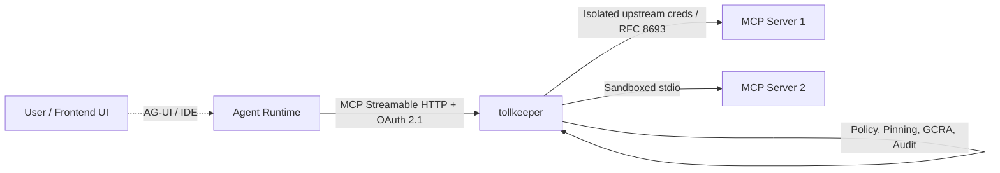

# Agent Platform Integrations

Copy-paste examples connecting popular coding agents, orchestration frameworks, and user-facing agent UIs to **tollkeeper** over MCP Streamable HTTP (`POST /mcp`).

In every integration below, the agent only ever talks to `tollkeeper` with its own OAuth 2.1 access token (or loopback dev mode locally). Upstream MCP credentials stay inside `tollkeeper` ([ADR 0005](../../docs/adr/0005-no-token-passthrough.md)), every tool call is checked against CEL policies and tool pins, and every intent and outcome is written to the hash-chained audit log.

| Platform | Transport | Key features demonstrated | Directory |
|---|---|---|---|
| **Claude Code** | Streamable HTTP (`.mcp.json` / `claude mcp add`) | Local & team OAuth 2.1 setup paired with [coding-agent-guardrails.yaml](../../policies/library/coding-agent-guardrails.yaml) | [claude-code/](claude-code/) |
| **Cursor** | Streamable HTTP (`.cursor/mcp.json`) | Project-scoped MCP config, static/env Bearer header, and tool pinning workflow | [cursor/](cursor/) |
| **LangGraph** | `langchain-mcp-adapters` (`streamable_http`) | `MultiServerMCPClient` with Bearer auth, W3C trace propagation, and RFC 9470 step-up detection | [langgraph/](langgraph/) |
| **OpenAI Agents SDK** | `MCPServerStreamableHttp` | Scoped tool discovery via `tools/list` filtering and authenticated MCP tool execution | [openai-agents/](openai-agents/) |
| **CrewAI** | `MCPServerAdapter` (Streamable HTTP) | Role-separated agent tokens with per-tenant/per-role policy and audit attribution | [crewai/](crewai/) |
| **AG-UI / CopilotKit** | AG-UI SSE (UI ↔ Agent) + MCP Streamable HTTP (Agent ↔ Tools) | Complementary protocol stack bridging Tollkeeper's RFC 9470 step-up challenges to AG-UI human-in-the-loop prompts | [ag-ui-copilotkit/](ag-ui-copilotkit/) |

> Looking for a 60-second local coding-agent setup with `tollkeeper init`? Start with [docs/guides/coding-agents.md](../../docs/guides/coding-agents.md).
