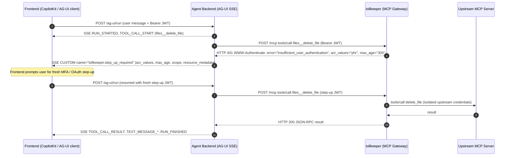

# AG-UI / CopilotKit + tollkeeper (RFC 9470 Step-Up Human-in-the-Loop)

[AG-UI](https://docs.ag-ui.com/introduction) is the open **Agent–User Interaction** protocol (streaming events between a frontend UI and an agent backend), while **MCP** is the **Agent–Tool** protocol governed by **tollkeeper**.

The two protocols complement each other cleanly without coupling the gateway to UI state:



## Why this separation matters

- **tollkeeper stays protocol-pure:** it enforces OAuth 2.1, DPoP, RFC 9470 step-up, CEL policies, tool pinning, GCRA rate limits, and tamper-evident audit at the MCP boundary.
- **AG-UI owns the user experience:** when Tollkeeper rejects a destructive call with `insufficient_user_authentication` or `insufficient_scope`, the agent backend emits a typed AG-UI `CUSTOM` event (`tollkeeper.step_up_required`) so CopilotKit or any AG-UI client can render an interactive approval / MFA re-authentication flow instead of surfacing a cryptic HTTP error.

## Run the bridge locally

```bash
pip install fastapi uvicorn httpx
export TOLLKEEPER_URL="http://localhost:8080/mcp"
uvicorn agent_server:app --host 127.0.0.1 --port 8000
```

Test a call against a running `tollkeeper` (for example with [destructive-step-up.yaml](../../../policies/library/destructive-step-up.yaml)):

```bash
curl -N -X POST http://127.0.0.1:8000/ag-ui/run \
  -H "Content-Type: application/json" \
  -H "Authorization: Bearer ${TOLLKEEPER_ACCESS_TOKEN}" \
  -d '{
    "threadId": "thread-1",
    "runId": "run-1",
    "tool": "files__delete_file",
    "arguments": {"path": "/tmp/old.log"}
  }'
```

If the token lacks `acr=phr` or fresh `auth_time`, the SSE stream emits a `CUSTOM` `tollkeeper.step_up_required` event containing the parsed `WWW-Authenticate` parameters ready for your frontend's OAuth/OIDC step-up redirect.

## Stateless Human-in-the-Loop Approval Tokens (`tk-approval+jwt`)

When a policy rule specifies `on_deny: { require_approval: true }` (see [stateless-governance.yaml](../../../policies/library/stateless-governance.yaml)), Tollkeeper responds with HTTP `403` and JSON-RPC `-32010` carrying `tool`, `args_hash`, `subject`, `header`, `reason`, and `ttl_s`. The bridge automatically translates this into a typed AG-UI `CUSTOM` event named `tollkeeper.approval_required`.

Once the human approves the exact operation in the UI, your approval backend signs a short-lived Ed25519 token (`tollkeeper approval sign`) and the frontend retries `/ag-ui/run` with `-H "X-Tollkeeper-Approval: <jwt>"` (plus optional `-H "Idempotency-Key: <uuid>"`). Tollkeeper verifies the signature, checks the canonical `args_hash`, enforces single-use replay protection, and records `approved_by` and `approval_id` in `audit.jsonl`.
